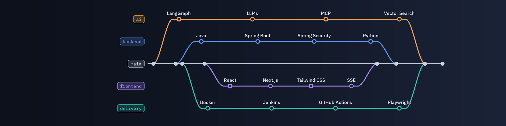

## Hi, I'm Riya Rakholiya

Software Engineer building secure backend systems and the AI agents that run on them.

I work across Java/Spring Boot and Python microservices, React/Next.js, and LLM agents. In my current role I've designed single-use refresh-token rotation, multi-tenant workflow variables with Kafka-driven cache invalidation, and agentic workflows with MCP tools.

### Tech stack

**Backend:** Java, Spring Boot, Spring Security, Python, Quart, Node.js 
**Data and events:** MongoDB, Apache Kafka, REST APIs, Server-Sent Events 
**AI:** LangGraph, LLMs, Model Context Protocol (MCP), Vector Search 
**Frontend:** React, Next.js, Tailwind CSS, Chrome Extensions 
**Delivery:** Docker, Jenkins, GitHub Actions, Playwright

### Currently building

- **secure-auth-service:** Spring Boot + MongoDB refresh-token rotation with replay detection
- **mcp-agent-workflow:** a LangGraph agent calling tools from a custom MCP server

### Connect

[LinkedIn](https://www.linkedin.com/in/riya-rakholiya) | [Email](mailto:riyarakholiya8610@gmail.com)
